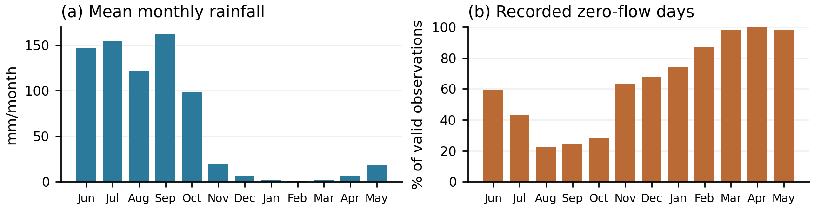

# Rainfall deficits and river-flow intermittency at Sarati

**Author: Ganesh Sonawane**

CE 766 - Watershed Management

This project examines rainfall variability and recorded zero-flow conditions in the Nira River catchment upstream of Sarati, Maharashtra. The study covers **1 June 1981 to 31 May 2011**, comprising 30 June-May hydrological years. The catchment is CAMELS-IND station **04049** (4049 in the discharge table), with a delineated area of 6,807.1 km2.

## Data and results

The [data folder](data/raw/sarati_source) contains the rainfall, observed-discharge and station-metadata extracts used by the code. The files are included so the calculations can be reproduced without downloading the full multi-catchment archive. Values, column names and missing cells have been preserved from the original dataset; only the required columns and Sarati metadata rows were selected.

Original repository: [CAMELS-IND v2.2, Zenodo record 14999580](https://zenodo.org/records/14999580). Original archive: `CAMELS_IND_Catchments_Streamflow_Sufficient.zip`. See [data provenance and attribution](data/README.md) for the exact source files, units, licence and citation.

Preliminary results:

| Measure | Result |
| --- | --- |
| Calendar days in the study window | 10,957 |
| Missing rainfall/discharge observations within the study window | 0 / 0 |
| Recorded zero-discharge days | 6,984 (63.74%) |
| Days with discharge at or below 0.1 m3/s | 7,016 (64.03%) |
| Recorded zero-flow fraction during March-May | 98.84% |
| Mean rainfall per hydrological year | 736.85 mm |
| Fraction of rainfall falling in June-September | 79.26% |
| Longest recorded zero-flow spell across the full window | 293 days, 23 October 2002-11 August 2003 |



Rainfall bars show monthly rainfall totals averaged over the 30-year study period. Zero-flow bars show the percentage of valid daily discharge observations recorded as zero for each calendar month. Months run from June to May.

## Reproduce the analysis

Use Python **3.11 or 3.12**. From the repository root:

```bash
python -m venv .venv
```

Activate the environment:

```powershell
# Windows PowerShell
.venv\Scripts\Activate.ps1
```

```bash
# Linux or macOS
source .venv/bin/activate
```

Then run:

```bash
python -m pip install -r requirements.txt
python analysis/preliminary_analysis.py
python analysis/verify_results.py
```

The first script recreates the tables and figure in [analysis/results](analysis/results). The second independently checks the principal reported statistics against the original daily values. GitHub Actions also runs these two commands.

## Methodology

- Check daily dates, duplicate dates, negative values, non-finite values and completeness. Retain missing discharge as missing. No simulated discharge is used.
- Calculate monthly and seasonal rainfall totals, recorded zero-flow fractions, near-zero sensitivity, seasonal discharge volumes and continuous zero-flow spells.
- Compute SPI-3 and SPI-6 from rolling rainfall totals. Fit gamma distributions with zero location to positive rainfall totals, separately for each calendar ending month, and account for the probability of a zero total. Use 1981-2020 ending months as the reference, with 1980 rainfall supplying antecedent months.
- Calculate exploratory, calendar-month-specific Spearman correlations for rainfall leads of 0-3 months. These screening results have not yet received block-bootstrap confidence intervals or a multiple-comparison assessment.

See [analysis notes](analysis/README.md) for metric definitions and verification details.

## Interpretation and remaining work

Recorded zero discharge does not by itself establish that the entire river channel was dry or that rainfall deficits caused the condition. Gauge recording practices, upstream regulation and abstraction require further investigation. Gamma-fit adequacy, rainfall-deficit event summaries and hydrological-year block-bootstrap uncertainty remain part of the next stage. The project does not yet estimate the benefits of a reservoir operating intervention.

## References

1. Mangukiya, N. K., et al. (2025). *CAMELS-IND: hydrometeorological time series and catchment attributes for 472 catchments in Peninsular India*, version 2.2. Zenodo. https://doi.org/10.5281/zenodo.14999580
2. Mangukiya, N. K., et al. (2025). CAMELS-IND: hydrometeorological time series and catchment attributes for 228 catchments in Peninsular India. *Earth System Science Data*, 17, 461-491. https://doi.org/10.5194/essd-17-461-2025
3. World Meteorological Organization (2012). *Standardized Precipitation Index User Guide* (M. Svoboda, M. Hayes and D. Wood), WMO-No. 1090. [Guide](https://www.droughtmanagement.info/literature/WMO_standardized_precipitation_index_user_guide_en_2012.pdf).
