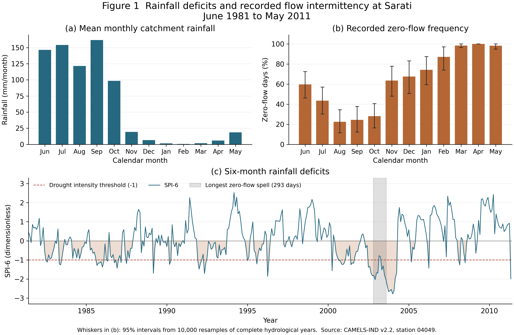
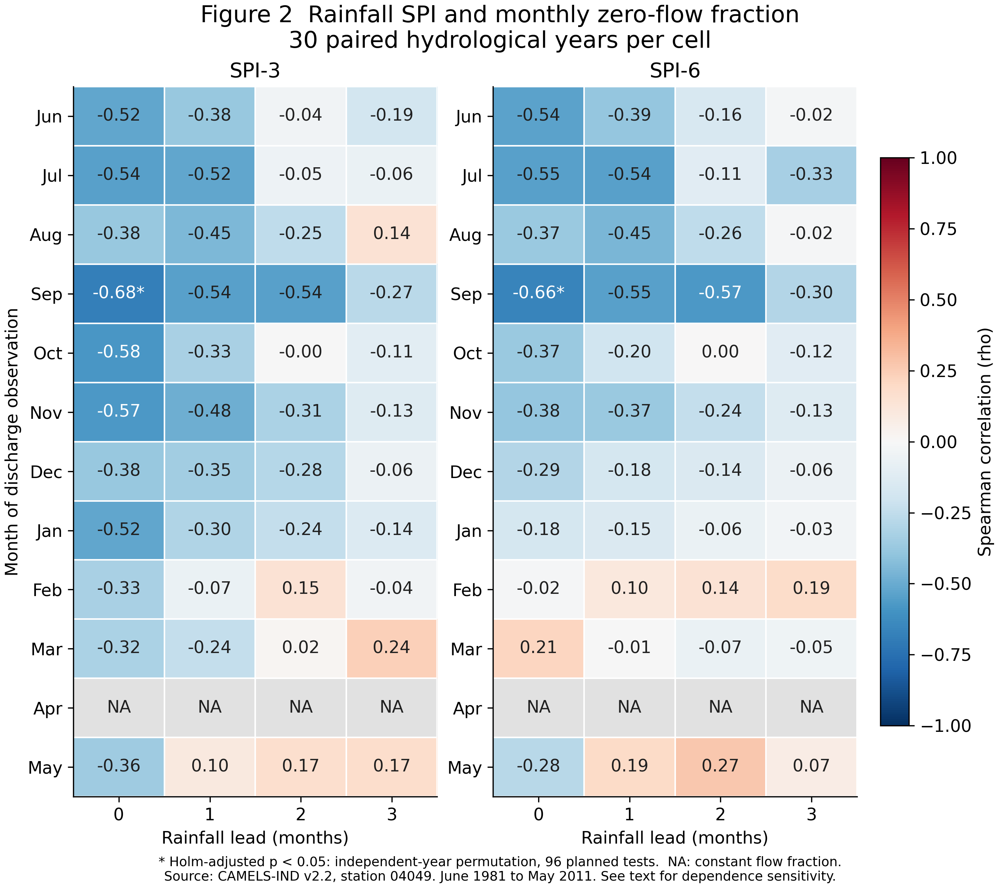

# Rainfall deficits and river-flow intermittency at Sarati

Author: Ganesh Sonawane

This is my CE 766 Watershed Management project on the Nira River catchment upstream of Sarati, Maharashtra. I used rainfall and observed discharge to examine when rainfall deficits coincide with recorded zero flow. The study covers June 1981-May 2011: 30 complete hydrological years for CAMELS-IND station 04049, with a delineated catchment area of 6,807.1 km2.

## Analysis outputs

- [Rainfall and recorded flow intermittency](analysis/final_results/Figure_1_Rainfall_and_Intermittency.png)
- [Lagged rainfall-flow associations](analysis/final_results/Figure_2_Lagged_Associations.png)
- [Calculated tables and diagnostics](analysis/final_results)
- [Method notes](analysis/README.md)

The analysis includes drought-event summaries, uncertainty calculations and sensitivity checks for the same catchment and study period. The earlier outputs remain in `analysis/results`; the completed analysis outputs are in `analysis/final_results`.

## What the results show

| Measure | Result |
| --- | --- |
| Recorded zero-flow days | 6,984 of 10,957 days, or 63.74% |
| March-May zero-flow fraction | 98.84% |
| Fraction at or below 0.1 m3/s | 64.03% |
| Mean annual catchment rainfall | 736.85 mm |
| June-September share of rainfall | 79.26% |
| Longest recorded zero-flow spell | 293 days, 23 October 2002-11 August 2003 |
| Largest SPI-6 drought magnitude | May 2002-April 2004; 24 months; minimum SPI -2.78 |
| Strongest rainfall-flow coefficient | September SPI-3 at zero lead: rho = -0.685 |

The September SPI-3 coefficient has a 95% year-bootstrap interval of -0.845 to -0.431. September SPI-6 gives rho = -0.663. These are the two associations that pass the primary Holm correction across 96 planned tests. None of the one- to three-month leads passes that correction. The strongest relationship uses rainfall ending in the discharge month, so it does not demonstrate advance-warning skill.





There is persistence between years. Sampling three-year blocks widens the September SPI-3 interval to -0.859 to -0.356. Permuting three-year blocks gives adjusted p-values of 0.048 and 0.057 for September SPI-3 and SPI-6. Those approximate values sit close to 0.05 and depend on the block assumption and Monte Carlo draws. I treat the associations as exploratory.

## Reproduce the analysis

Use Python 3.11 or 3.12. From this folder:

```bash
python -m venv .venv
```

Activate the environment in PowerShell:

```powershell
.venv\Scripts\Activate.ps1
```

On Linux or macOS:

```bash
source .venv/bin/activate
```

Then run:

```bash
python -m pip install -r requirements.txt
python analysis/preliminary_analysis.py
python analysis/verify_results.py
python -m unittest discover -s tests -v
python analysis/final_analysis.py
python analysis/verify_final_results.py
```

`final_analysis.py` reads the source extracts directly. It does not require the preliminary tables. The tests compare the two SPI implementations and check ties, lag alignment, event boundaries, constant samples and block construction.

The final calculation uses seed `7662026` with:

- 10,000 paired year-bootstrap draws for each of three block lengths: one, two and three years;
- 19,999 permutations for each of the independent-year and three-year-block tests;
- 999 simulated and refitted samples for each of the 24 gamma-fit checks;
- 2,000 resamples of the 40 reference years for SPI fitting uncertainty.

These are statistical resampling calculations. I did not generate synthetic daily rainfall or flow, simulate reservoir operations, or estimate intervention benefits. [The method notes](analysis/README.md) describe the equations and assumptions. [run_config.json](analysis/final_results/run_config.json) records the actual counts and software versions.

GitHub Actions runs the analyses and checks after each push, then saves the calculated tables and figures as a workflow artifact.

## Data and interpretation

The [input files](data/raw/sarati_source) are Sarati extracts from [CAMELS-IND v2.2](https://doi.org/10.5281/zenodo.14999580). Rainfall is the catchment average of IMD's 0.25-degree daily grid. Discharge is the observed CWC/India-WRIS gauge series, not the separate LSTM prediction product. The [data notes](data/README.md) identify the files and checksums.

A complete compiled series does not establish that the entire river channel was dry. Release, diversion, abstraction and gauge-quality records were unavailable in this analysis. The findings can guide seasonal monitoring, but an operational release rule needs those records and testing on independent years. The proposed monthly SPI review trigger is unvalidated.

The final code preserves the source rainfall precision before ranking, removing floating-point differences between equal totals. Three exploratory dry-season correlations change slightly. The previously reported summary statistics and main September results remain unchanged.

## References

1. Mangukiya, N. K., et al. (2025). CAMELS-IND: hydrometeorological time series and catchment attributes for 228 catchments in Peninsular India. *Earth System Science Data*, 17, 461-491. https://doi.org/10.5194/essd-17-461-2025
2. Mangukiya, N. K., et al. (2025). *CAMELS-IND: hydrometeorological time series and catchment attributes for 472 catchments in Peninsular India*, version 2.2. Zenodo. https://doi.org/10.5281/zenodo.14999580
3. World Meteorological Organization (2012). *Standardized Precipitation Index User Guide*, WMO-No. 1090. [Guide](https://www.droughtmanagement.info/literature/WMO_standardized_precipitation_index_user_guide_en_2012.pdf).
