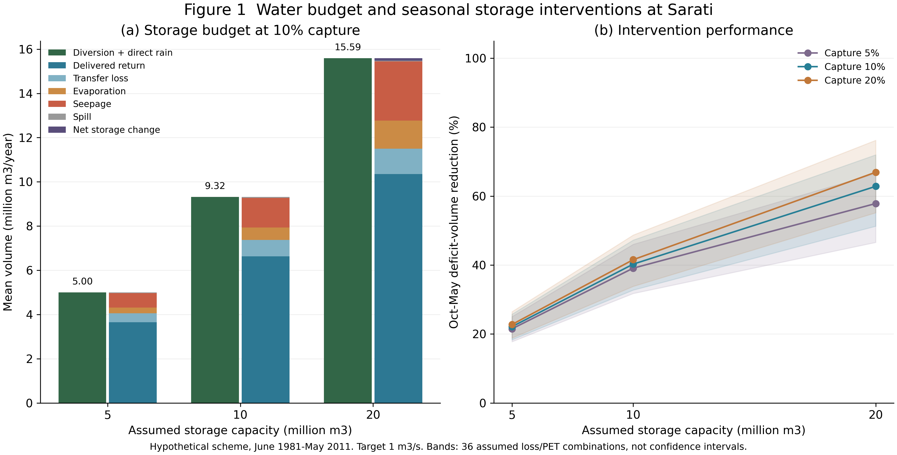
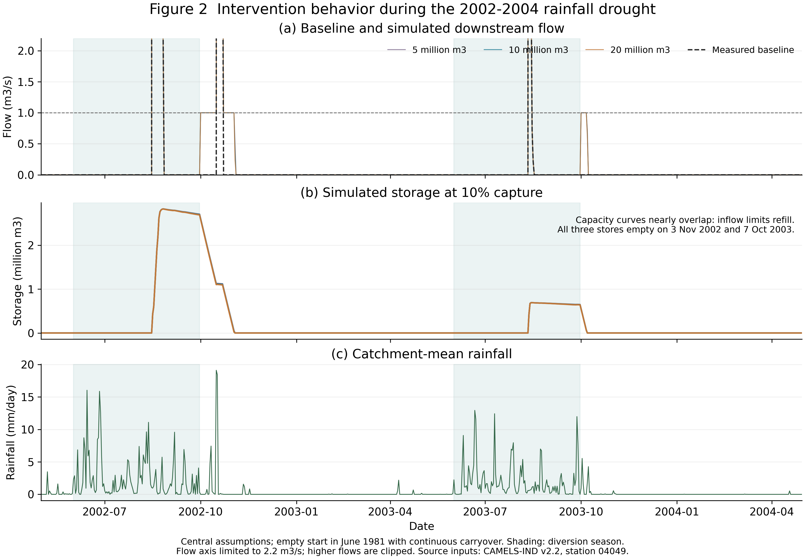

# Rainfall deficits and seasonal storage at Sarati

Author: Ganesh Sonawane

This CE 766 Watershed Management project examines rainfall deficits and downstream flow availability in the Nira River catchment at Sarati, Maharashtra. The study covers June 1981-May 2011, using CAMELS-IND station 04049 and its 6,807.1 km2 delineated catchment.

The project includes historical rainfall/flow analysis and a daily water-budget model of a hypothetical off-channel storage unit just downstream of the gauge. The storage model compares a no-new-storage baseline with seasonal diversion and release interventions. It uses the same historical flow record, while capacities and operating rules are explicit assumptions.

## Water-budget model

The model diverts part of June-September flow above an assumed 1 m3/s bypass floor, stores it with rainfall, evaporation and seepage accounting, and releases water during October-May. The illustrative downstream target is 1 m3/s. It is not an assessed ecological flow requirement.

Nine designs combine capacities of 5, 10 and 20 million m3 with capture fractions of 5%, 10% and 20%. Each design is evaluated under 36 PET/loss combinations, giving 324 deterministic combinations. Another 36 runs test the target, starting storage and timestep. The model does not assign probabilities to the uncertainty combinations.

For the central 10-million-m3, 10%-capture case:

| Measure | Result |
| --- | --- |
| Mean October-May deficit volume | 16.48 million m3/year in the baseline; 9.85 with intervention |
| Deficit-volume reduction | 40.26%; scenario range 32.75-47.24% |
| October-May days meeting 1 m3/s | 20.32% in the baseline; 52.84% with intervention |
| Mean annual diversion | 8.90 million m3, or 0.93% of monsoon flow |
| Mean annual delivered return | 6.64 million m3 |





Larger capacity improves average performance, but the severe 2002-2004 drought is supply limited. At 10% capture, all three capacities empty on 3 November 2002 and 7 October 2003. Extra capacity cannot replace missing inflow. Evaporation, seepage and transfer losses are counted explicitly, and the combined river-storage balance is checked daily.

The model holds existing upstream regulation fixed in the observed boundary flow. It does not reoperate Bhatghar or Vir. Geometry, seepage, delivery efficiency, capture thresholds and target flows are uncalibrated assumptions. Results support conditional screening; they do not establish siting feasibility, an entitlement to divert or an economic optimum. Full equations and assumptions are in [the water-budget notes](analysis/water_budget_methods.md).

## Inputs and outputs

- [Data notes and source attribution](data/README.md)
- [Additional original PET/AET forcing extract and provenance](data/raw/water_budget_forcings)
- [Water-budget parameters, daily outputs and scenario summaries](analysis/water_budget_results)
- [Historical SPI, flow and uncertainty results](analysis/final_results)
- [Historical calculation notes](analysis/README.md)

The data come from [CAMELS-IND v2.2](https://doi.org/10.5281/zenodo.14999580). Rainfall is based on IMD's 0.25-degree daily grid and discharge on CWC/India-WRIS observed records. PET and AET are supplied catchment means from Singer/GLEAM products. No source values were filled or replaced. Model outputs are simulated, and all design parameters are identified as assumptions.

## Reproduce

Use Python 3.11 or 3.12. Create an environment and install the pinned analysis packages:

```bash
python -m venv .venv
```

Activate it with `.venv\Scripts\Activate.ps1` in PowerShell, or `source .venv/bin/activate` on Linux/macOS. Then run:

```bash
python -m pip install -r requirements.txt
python analysis/preliminary_analysis.py
python analysis/verify_results.py
python -m unittest discover -s tests -v
python analysis/final_analysis.py
python analysis/verify_final_results.py
python analysis/water_budget.py
python analysis/verify_water_budget.py
```

The water-budget model reads the original extracts directly, without requiring the earlier SPI outputs. It uses no random draws. The earlier statistical analysis retains its documented seed and resampling counts. The independent budget checker reconstructs the central trajectory from the raw CSV files and checks saved balances using Decimal arithmetic.

GitHub Actions reruns both analyses, tests and independent checks, then uploads analysis results only. Report documents, form answers and report-building code are kept outside version control.

## Historical context

The observed record has zero discharge on 63.74% of study days, rising to 98.84% in March-May. The longest recorded spell is 293 days. These are compiled gauge observations; independent field checks are needed to establish channel dryness. The earlier month-specific analysis found its strongest rainfall-flow relationship in September, without establishing one- to three-month forecasting skill. Those results motivate seasonal storage screening and remain available for comparison.

## References

1. Mangukiya, N. K., et al. (2025). CAMELS-IND: hydrometeorological time series and catchment attributes for 228 catchments in Peninsular India. *Earth System Science Data*, 17, 461-491. https://doi.org/10.5194/essd-17-461-2025
2. Mangukiya, N. K., et al. (2025). *CAMELS-IND*, version 2.2 [Data set]. Zenodo. https://doi.org/10.5281/zenodo.14999580
3. USACE Hydrologic Engineering Center. *HEC-HMS Technical Reference Manual*: [reservoir continuity](https://www.hec.usace.army.mil/confluence/hmsdocs/hmstrm/reservoir-modeling/reservoir-modeling-concepts-and-equations) and [evaporation](https://www.hec.usace.army.mil/confluence/hmsdocs/hmstrm/reservoir-modeling/reservoir-modeling-concepts-and-equations/evaporation). The project implements a separate daily Python storage model.
